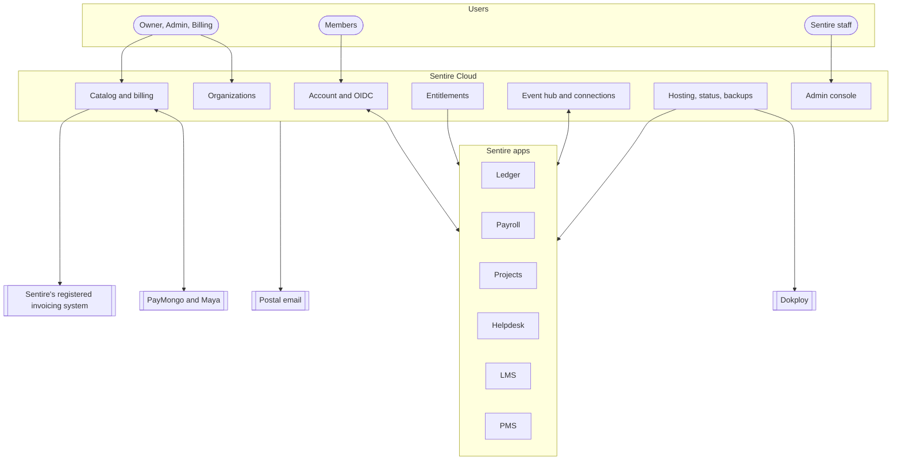

# Sentire Cloud: Blueprint

**Version 1.2, 25 November 2026.** Version 1.1 added the tenancy model and the paywall (sections 4.6, 5.6 and 6.5). Version 1.2 records the owner's decisions (section 10): Sentire is the only seller, and there are no existing clients to migrate. Companion documents: Build Plan, System Design, CLAUDE.md, README.md.

## 1. Purpose

Sentire Cloud is the centre of every Sentire app. A client company signs up once, pays once, manages its people once, and every Sentire app it uses (Ledger, Payroll, Projects, Helpdesk, LMS, PMS) trusts Sentire Cloud for three answers:

1. **Who is this person, and which company are they acting for?** (Sentire Account)
2. **What has this company paid for, and what may it do?** (billing and entitlements)
3. **Which other Sentire apps is it connected to, and where does it run?** (connections and hosting)

Today each app answers these on its own: Ledger has its own users, tiers and PH Subscription record; Payroll has its own sign-in; the status console is a separate page. Sentire Cloud replaces those parallel copies with one source, so a client experiences Sentire as one ecosystem.

## 2. Scope

### 2.1 In scope

| Module | What it covers |
|---|---|
| Sentire Account | Sign-up, sign-in, email verification, password reset, two-factor (TOTP, passkeys), sessions, OpenID Connect provider for all apps, app switcher data |
| Organizations | Client company profile (TIN, branch, VAT status), members, organization roles, per-app access, invitations, ownership transfer |
| Catalog | Products, plans, prices (monthly, annual, one-time), setup fees, add-ons, bundles, limits, metered rates, price versions |
| Billing | Subscriptions, billing statements, payments (PayMongo, Maya, bank transfer), saved payment methods, renewals, proration, dunning, credit notes, refunds, withholding and 2307 tracking |
| Entitlements | Derived per organization and app, down to single features and limits; API, signed token and change events |
| Paywall | Feature catalog, upgrade card for every app, upgrade from inside an app with return, upgrade requests from members, usage-limit paywalls, feature trials, paywall figures |
| Connections | App registry, OIDC clients, event hub (sentire.event.v1), connections per organization, delivery log, machine credentials |
| Hosting | Instances (shared and dedicated), provisioning, servers, status checks and incidents (today's console), backup records, export and deletion |
| Admin console | Staff view of everything above, audit log, business figures |

### 2.2 Out of scope

- Client business data (books, payroll, tickets, bookings, courses). It stays in each app.
- App-level roles and permissions (for example Ledger's Owner, Accounting Manager, Accountant, Staff role sets). Sentire Cloud only says whether a member may open the app.
- Building a hosting control panel that replaces Dokploy. Dokploy stays the engine; Sentire Cloud calls its API.
- Issuing BIR invoices before Sentire Cloud is registered as an invoicing system (System Design CR-01).
- A marketplace for third-party apps.

## 3. Principles

1. **One source per fact.** Identity, organization, subscription and entitlement live only in Sentire Cloud. Apps cache, never own, these facts.
2. **Apps keep working when Sentire Cloud is down.** Cached sessions and entitlements carry an app through an outage; no app ever loses or hides data because Sentire Cloud did not answer.
3. **Money is a ledger.** Append-only statements, payments and credit notes, integer centavos, idempotent webhooks.
4. **Standards over custom.** OpenID Connect for sign-in, JWT for tokens, signed webhooks in the sentire.event.v1 format already used by Sentire Framework.
5. **Small first.** The first release serves one app (Ledger) end to end: sign-in, billing, entitlement, status. Other apps adopt it one at a time.
6. **Visible staff power.** Everything staff do is logged; client data inside apps needs the Owner's consent.
7. **A fair paywall.** Features are locked on the server, the upgrade is one click away for the person who can pay, and locked features or reached limits never hide or delete existing data.

## 4. Architecture

### 4.1 Context

### 4.2 Components

| Component | Responsibility | Runs as |
|---|---|---|
| Web app | Portal for clients, admin console for staff, public status page, all HTTP APIs | Next.js server, Dokploy app `sentire-cloud` |
| OIDC provider | Authorization, token, user info, JWKS, discovery, end-session, back-channel logout | Mounted in the web app at `/oidc` (node-oidc-provider) |
| Worker | Renewals, dunning, event delivery and retries, health checks, provisioning jobs, key rotation, backup checks, emails | Same image, second Dokploy app `sentire-cloud-worker`, pg-boss |
| Database | All Sentire Cloud data | Shared Postgres 18, database `sentire_cloud` |
| File store | Statement PDFs, 2307 uploads, exports | RustFS bucket `sentire-cloud` |

### 4.3 Domains

| Host | Serves |
|---|---|
| `cloud.sentire.solutions` | Portal, sign-in, OIDC issuer, APIs, admin console (needs an A record to 91.90.80.4) |
| `status.sentire.solutions` | Public status page (same app) |
| `cloud.apps.sentire.solutions` | Current console; redirects to the status page after Phase 1 |

The issuer URL `https://cloud.sentire.solutions` is permanent once apps trust it; changing it later forces every app to reconfigure.

### 4.4 Technology stack

| Layer | Choice | Why |
|---|---|---|
| Language and framework | TypeScript (strict), Next.js 16 App Router | Same as Projects, Payroll and PMS; one developer, one stack |
| Database | Postgres 18 with Drizzle ORM, SQL migrations applied on boot | Same as Sentire Projects; shared instance already backed up |
| Jobs | pg-boss | Durable queue in the same Postgres, no extra service |
| Identity | node-oidc-provider (OpenID certified), argon2id, otplib (TOTP), SimpleWebAuthn (passkeys) | Proven libraries instead of hand-written token logic |
| Payments | PayMongo and Maya for Business, hosted checkout and webhooks | Agreed providers; no card data on Sentire servers |
| Events | sentire-kit (`buildEvent`, `sign`, `verify`) from Sentire Framework | Same format on Python and TypeScript sides |
| UI | Tailwind CSS with Sentire Designs tokens (`tokens.css`) | Shared look across apps |
| PDF | Chrome headless printing of HTML statements | Exact layout control for statements |
| Email and SMS | Postal (SMTP2GO relay), Semaphore | Existing services |
| Tests | Vitest (unit and integration), Playwright (end to end) | Same as other Next.js apps |
| Hosting | Dokploy on the Contabo app server; ALC Hosting servers as Dokploy remote servers later | Existing platform |

### 4.5 Data ownership

| Data | Owner | Copies elsewhere |
|---|---|---|
| User identity, credentials, two-factor | Sentire Cloud | None (apps keep `sub`, name, email) |
| Organization profile, members, app access | Sentire Cloud | Apps keep a cached copy, refreshed by events |
| Subscriptions, statements, payments, 2307s | Sentire Cloud | Sentire's own Ledger company receives paid statements to issue invoices |
| Entitlements | Sentire Cloud (derived) | Apps cache for 24 hours |
| App roles and business data | Each app | None |
| Status and incident history | Sentire Cloud | None |

### 4.6 Tenancy and users

| Concept | Meaning |
|---|---|
| Tenant | One organization (client company). Every tenant-owned row carries `organization_id`; the data-access layer refuses queries without it; tests prove isolation. |
| User | One Sentire Account per person, across all tenants and apps. |
| Membership | A user's place in one organization, with an organization role (Owner, Admin, Billing, Member) and per-app access. One user can hold memberships in many organizations. |
| App tenancy | Each app maps the organization to its own tenant unit (a Ledger site, a Payroll company, a Projects workspace) through the `org_id` claim. |
| Staff | Sentire staff are users with a platform role; they are not members of client organizations and see client data inside apps only with consent. |

## 5. Integration contracts with the apps

Every Sentire app that joins Sentire Cloud implements the same six contracts. Frappe apps (Ledger, Helpdesk, LMS) do it through a small Sentire Cloud module in their app (later in Sentire Framework); Next.js apps through sentire-kit.

### 5.1 Sign-in (OpenID Connect)

- Authorization code flow with PKCE; scopes `openid profile email org entitlements`.
- ID token claims: `sub`, `email`, `name`, `org_id`, `org_name`, `org_role`, `app_access` (true), `ent` (`state`, `plan`, `addons`, `limits`, `version`).
- Access token lifetime 10 minutes; refresh token 12 hours, rotated on use.
- Back-channel logout to each app's registered URI when a user signs out or is removed.
- Ledger: Frappe Social Login Key pointed at the issuer, plus a ph_cas hook that maps `org_id` to the Ledger site and `org_role` to a default role set.

### 5.2 Entitlements

- `GET /api/v1/entitlements/{orgId}/{appId}` with a machine token: returns the entitlement JSON and `version`, including `features` (each with its source) and `limits` (each with value and mode: soft, hard or overage).
- Event `account.entitlement.changed` on every change; apps refresh on receipt.
- Apps cache for 24 hours and enforce limits locally.

### 5.3 Usage reporting

- `POST /api/v1/usage` with `{orgId, appId, meter, quantity, periodDate, idempotencyKey}`.
- Daily counts (users, branches, invoices this month) for display; metered items (AI tokens, SMS) for billing in P2.

### 5.4 Events

- Apps send to `POST /api/v1/events` with header `X-Sentire-Signature`, body in the sentire.event.v1 format.
- Apps receive at their registered event endpoint, verify the signature with their own instance secret, and apply each `eventId` once.
- Account events: `account.organization.created`, `account.organization.updated`, `account.member.added`, `account.member.updated`, `account.member.removed`, `account.entitlement.changed`, `account.connection.enabled`, `account.connection.disabled`.
- Billing events: `billing.statement.paid`, `billing.subscription.changed`.
- App-to-app events (P2): `payroll.run.approved`, `payroll.run.paid`, `ledger.journal.posted`, `ledger.task.created`, `projects.task.updated` (defined in sentire-kit).

### 5.5 Provisioning and offboarding

| Call (from Sentire Cloud to the app) | App does |
|---|---|
| `POST /sentire/provision` `{orgId, plan, limits, owner}` | Creates the organization's site or workspace; returns `{instanceUrl}` |
| `POST /sentire/suspend` and `/sentire/resume` | Sets read-only or full access (also implied by the entitlement) |
| `POST /sentire/export` | Starts a full export; calls back with the file location when ready |
| `POST /sentire/delete` | Deletes the organization's data; returns the deletion certificate |
| `GET /sentire/health` | Returns status and version |

All calls are signed with the instance secret and idempotent by job ID. Ledger already has site creation, export and the deletion certificate (hosting and offboarding runbooks), so its endpoints wrap existing code.

### 5.6 Paywall

- **Check:** `hasFeature(key)` and `withinLimit(key, count)` read the cached entitlement (under 1 ms). sentire-kit provides them for Next.js apps; a small Sentire Cloud module provides them for Frappe apps.
- **Refuse on the server:** a locked action answers HTTP 402 with `{"code": "PAYMENT_REQUIRED", "feature": "<key>", "upgradeUrl": "<url>"}`.
- **Show the card:** the shared upgrade card reads the 402 answer and shows the feature, benefit, cheapest unlocking plan or add-on and price, with **Upgrade** (Owner, Billing) or **Ask my Owner** (everyone else).
- **Upgrade address:** `https://cloud.sentire.solutions/upgrade?org={orgId}&feature={key}&return={appUrl}`. Sentire Cloud picks the cheapest option, runs checkout, then redirects to `return` with `?entitlement=refresh`.
- **Requests:** **Ask my Owner** posts to `POST /api/v1/upgrade-requests` with the user's token.
- **Events:** `account.entitlement.changed` (already in 5.2), `paywall.request.created` and `paywall.request.decided` (so apps can tell the requester).

## 6. Billing model

### 6.1 Selling entity and tax

- Sentire is the seller of every product. Its seller profile holds the registered name, TIN, address and tax status. The default is non-VAT (3% percentage tax, gross sales under PHP 3 million), switchable to VAT without code changes.
- Sentire Cloud issues **billing statements**. The BIR invoice is issued by Sentire's own registered system when a statement is paid (CR-01), and its number is written back to the statement.

### 6.2 Catalog content at launch

| Product | Plans | Source |
|---|---|---|
| Sentire Ledger | Solo PHP 1,490, Team PHP 3,990, Business PHP 9,990, Enterprise from PHP 24,990 a month, billed annually; setup fees PHP 5,000, 10,000, 25,000, from 75,000; 14-day paid pilot credited to setup | Ledger commercial model, 9 Nov 2026 |
| Other products | Added when each product sets its prices | Each product's plan |
| Hosting (PH-hosted servers) | Added after the ALC Hosting quote and test (CLD-2 to CLD-6) | CLD project |

No new prices are set in this blueprint.

### 6.3 Collections

- Online: PayMongo or Maya hosted checkout for card, GCash and Maya; payment links for renewals; saved methods where the provider supports recurring charges (confirmed in the Phase 2 spike).
- Offline: bank transfer recorded by staff against the statement.
- Withholding: payment recorded net; the withheld amount tracked until the 2307 is received.
- Dunning: day 0, 3, 7 reminders; day 8 suspended (read-only); day 30 cancelled; reactivation on payment.

### 6.4 Paywall packaging

- Every product names its features in the catalog, then places each in a plan or add-on. Moving a feature between plans is a catalog change, not a code change.
- Ledger keeps its current model: no free trial and no free tier; the 14-day paid pilot stays. Feature trials (FR-50) are an optional sales tool, not a free tier.
- Limits come from each plan (for Ledger: users, companies, branches, invoices a month). Their mode (soft, hard or overage) is set per plan by staff.
- Which features are paid in each product is an owner decision (decision 6). No feature placement is decided in this blueprint.

### 6.5 AI margin protection

Heavy in-product AI is the main threat to gross margin (the Project's financial model shows it can fall from about 88% to 49 to 61%). Sentire Cloud supports the agreed mitigations: AI as a paid add-on or higher-tier feature behind the paywall (`ai.assistant` feature with a monthly limit), metered AI usage reported by apps (FR-21) with overage billing or a hard stop (FR-49), and a staff view of AI cost against AI revenue per organization (FR-43).

## 7. Security model

| Area | Control |
|---|---|
| Passwords | argon2id, minimum 12 characters, breached-password check, lockout after 10 failures for 15 minutes |
| Two-factor | TOTP and passkeys; required for Owners and staff; recovery codes |
| Tokens | ES256 signing keys in the database encrypted with a key from the environment; rotation every 90 days; JWKS endpoint |
| App secrets | One OIDC client secret and one event secret per app instance, stored hashed or encrypted; rotation supports two active secrets |
| Machine access | Client credentials, scoped to one organization and named scopes, 5-minute tokens |
| Staff | Platform roles; consent-based, time-limited access to client data inside apps; every action audited |
| Data | Organization isolation in the data-access layer and tests; nightly encrypted backups; files in a private bucket with signed URLs |
| Web | HTTPS and HSTS, CSRF tokens, strict content security policy, rate limits on sign-in, reset, invite and webhook endpoints |

## 8. Rollout

| Step | What changes for clients |
|---|---|
| 1. Sentire Cloud live with accounts, organizations, catalog, billing and status (Phases 1 to 3) | New Ledger clients sign up and pay at cloud.sentire.solutions |
| 2. Ledger signs in through Sentire Cloud and reads its entitlement (Phase 4) | Ledger users get one Sentire Account; the PH Subscription record in Ledger becomes a read-only mirror |
| 3. Payroll, then Projects, Helpdesk, LMS and PMS adopt it (Phase 5 and later) | One sign-in and one bill across apps |
| 4. Connections and the event hub (Phase 5) | Payroll to Ledger and Ledger to Projects links switched on per client |

## 9. Risks

| Risk | Effect | Response |
|---|---|---|
| Sentire Cloud becomes a single point of failure for sign-in | All apps unreachable for new sign-ins during an outage | 99.9% target, health alerts, cached sessions and entitlements in apps, restore drill |
| Building the platform delays revenue | Months on infrastructure instead of selling Ledger | Phase 1 to 4 scope is only what Ledger needs to bill its first clients; connections and hosting automation wait |
| Payment provider recurring features differ from expectations | Auto-renewal not possible for some methods | Payment-link renewals as the default; saved-card charging only where confirmed |
| BIR treatment of statements and invoices | Non-compliant invoicing | Statements only until registration; invoices from the registered system (CR-01); confirm with RDO |
| Identity bugs | Account takeover across every app | Certified OIDC library, two-factor for Owners, security review before go-live, rate limits |
| Paywall annoys paying clients | Churn, support load | Upgrade card only on real locked actions, warnings at most once a day, never hides existing data, Owners can decline requests in one click |
| Paywall bypass through an API or old screen | Unpaid use | Server-side 402 checks in every app, tests that call locked endpoints directly |

## 10. Decisions (settled 25 November 2026)

1. **Seller.** Sentire is the only seller of every product in Sentire Cloud.
2. **Invoice route.** Sentire Cloud issues billing statements; the BIR invoice comes from Sentire's own Ledger company through the event hub, until Sentire Cloud is registered.
3. **Domains.** `cloud.sentire.solutions` for the portal and issuer, `status.sentire.solutions` for status; A records to 91.90.80.4 added at GoDaddy.
4. **First release.** Phases 0 to 4 (Ledger end to end), built in one run.
5. **Existing clients.** None. No migration is needed; Ledger moves straight to Sentire Cloud sign-in.
6. **Paywall.** Start with one paid add-on across apps, the AI assistant (`ai.assistant`, monthly limit, hard stop); other plans stay as they are.
7. **Free tier.** None for now.
